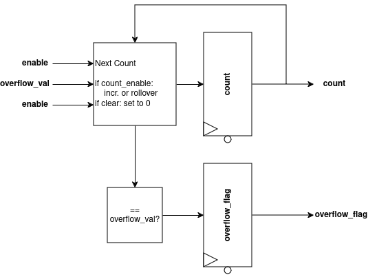
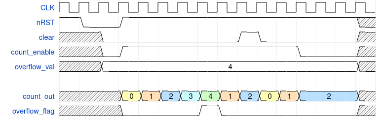

# Counter
A simple binary up-counter.

## RTL Diagram

The counter consists of two registers for the count value and overflow flag, and a small amount of combinational
logic to update them. The "Next Count" combinational block takes `count_enable`,
`overflow_val`, and `clear` as inputs and computes the next value for the
`count` register: incrementing or rolling over when `count_enable` is high,
or zeroing when `clear` is high. The `count` register output drives the
`count_out` port and feeds back into the Next Count logic. A comparator
checks whether the next count equals `overflow_val`, and its result is
registered to drive the `overflow_flag` output.

## Sample Waveform

The waveform shows the counter operating with `overflow_val` set to 4.
After reset is released and `count_enable` goes high, `count_out` increments
each cycle: 0, 1, 2, 3, 4. When the count reaches 4, `overflow_flag` is
asserted for one cycle, and the counter rolls over to 1 on the next cycle.
A pulse on `clear` synchronously resets `count_out` to 0 regardless of
`count_enable`. When `count_enable` is deasserted, the counter holds its
current value.
Note that this behavior requires the counter to have at least 3 bits, such that 4 is a valid `overflow_val`.

## I/O
| Port Name | Direction | Type | Description |
|:---------:|:---------:|:----:|:-----------|
| `CLK` | `input` | `logic` | Clock |
| `nRST` | `input` | `logic` | Active-low asynchronous reset |
| `clear` | `input` | `logic` | Synchronous reset of count value |
| `count_enable` | `input` | `logic` | Enables counting in the current cycle |
| `overflow_val` | `input` | `logic [NBITS-1 : 0]` | Compare value for setting `overflow_flag`. Valid range: `>= 2`; `0` and `1` are unsupported (`0` prevents `overflow_flag` from ever asserting, since the counter always rolls over to `1` before comparing equal) |
| `count_out` | `output` | `logic [NBITS-1 : 0]` | Current counter value |
| `overflow_flag` | `output` | `logic` | Indicates that the count hit the `overflow_val` |

## Function
When `count_enable` is high, the counter will increment by 1 each cycle until `count` == `overflow_val`; counting past `overflow_val` will cause the counter to roll over to **1** (as `overflow_val` itself is the last valid count). Setting the `clear` input will synchronously reset the counter to zero. Note that `clear` takes effect regardless of the state of `count_enable`.

The `overflow_flag` is set when `count` == `overflow_val`, and cleared when the count rolls over. `overflow_flag` is driven from a register.

On reset, `count` and `overflow_flag` are 0. 

## Parameters
| Parameter     | Type | Description | Default Value | Valid Range |
|:---------------:|:------:|:-------------|:---------------:|:-------------:|
| `NBITS` | `int` | Number of bits to use in the counter | 4 | >= 1 |
